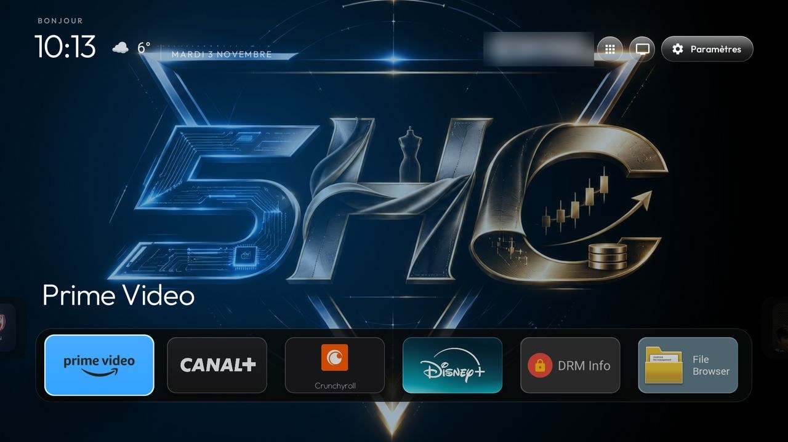
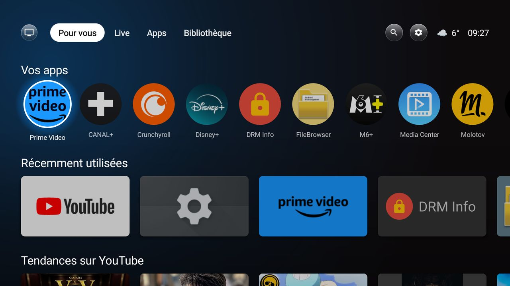
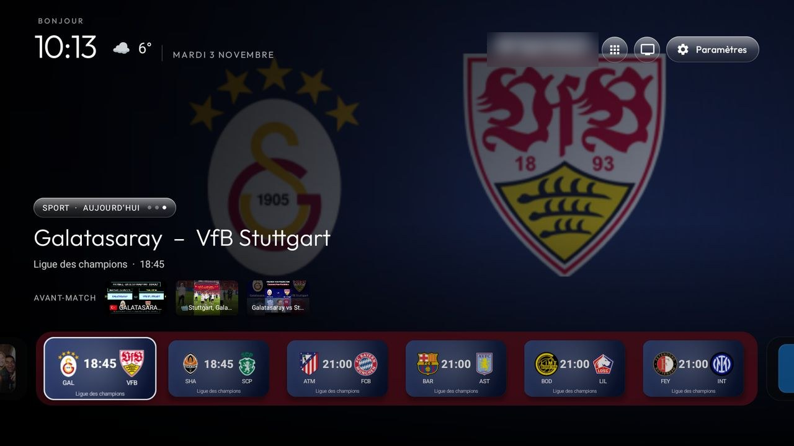
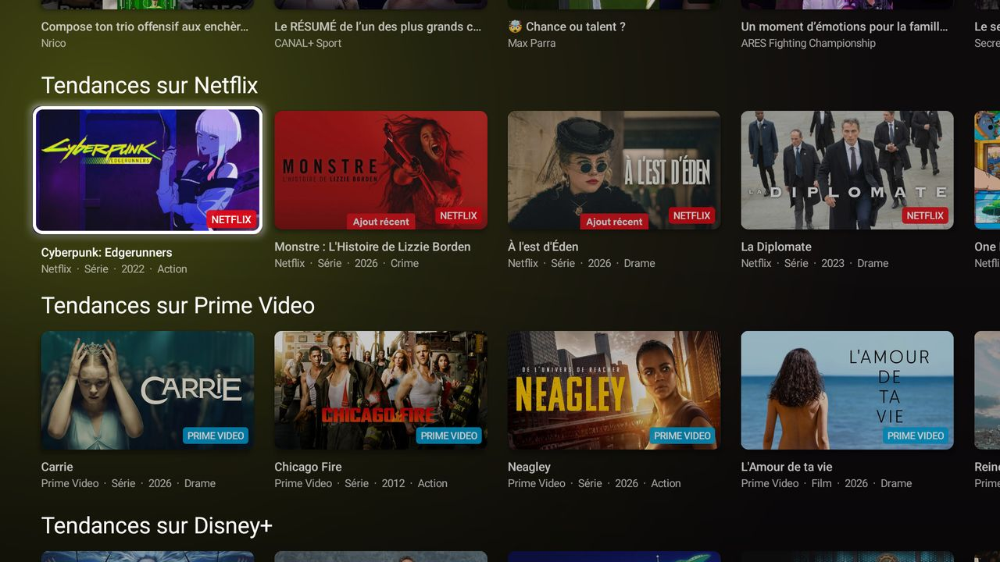
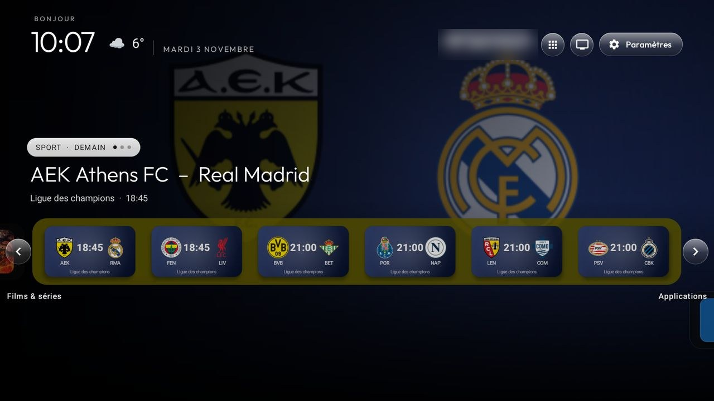
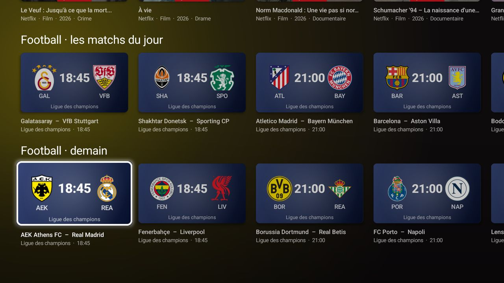
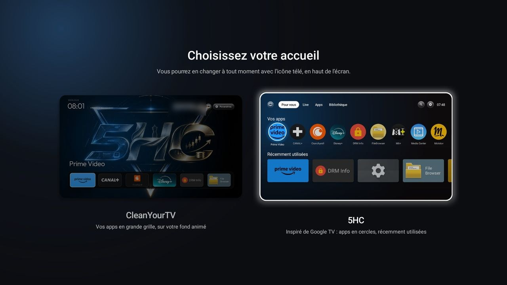
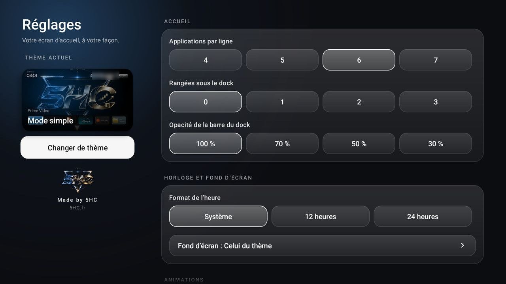

# CleanYourTV × 5HC

Fork de [Gathin23/cleanyourtv](https://github.com/Gathin23/cleanyourtv) (licence MIT), pensé et testé sur une box
Android TV chinoise **X88 Pro 13** (Rockchip RK3528, Android 13). Le dépôt d'origine nettoie la box et remplace son
accueil plein de pubs par un launcher propre. Ce fork ajoute un deuxième accueil inspiré de Google TV, des « volets »
YouTube, films et séries, et sport, la météo, et toute la personnalisation 5HC (intro, outro, veille vidéo).

> Tout ce que fait le dépôt d'origine reste valable : commence par son [README](README.md) et son [PROMPT.md](PROMPT.md)
> pour nettoyer ta box. Ce fichier décrit seulement ce que le fork ajoute.

| Mode simple | Mode personnalisé |
|---|---|
|  |  |
|  |  |
|  |  |
|  |  |

## Sommaire

1. [Ce que le fork ajoute](#ce-que-le-fork-ajoute)
2. [Installer](#installer)
3. [Les clés API : tutoriels](#les-clés-api--tutoriels)
4. [Donner les clés à la box](#donner-les-clés-à-la-box)
5. [Quotas et requêtes](#quotas-et-requêtes)
6. [Confidentialité](#confidentialité)
7. [Pour développer (MCP)](#pour-développer-mcp)
8. [Adapter à une autre box](#adapter-à-une-autre-box)
9. [Où est quoi dans le code](#où-est-quoi-dans-le-code)
10. [Crédits](#crédits)

## Ce que le fork ajoute

**Deux accueils, au choix** (écran de choix au premier démarrage, puis icône télé → *Changer de thème*) :

- **Mode simple** : l'accueil CleanYourTV (grille d'apps, fond animé, grand nom de l'app). Les **volets** sont en
  carrousel autour du dock : *Apps → YouTube → Films & séries → Sport → Apps*. Les voisins dépassent sur les bords,
  Droite/Gauche au bout d'une rangée fait glisser le volet suivant, Bas/Haut change de thème. Haut depuis la première
  rangée sélectionne le titre du volet : Gauche/Droite saute alors de volet en volet, avec des flèches qui les nomment.
  L'image de la carte sélectionnée remplit l'écran derrière.
- **Mode personnalisé** : une mise en page à la Google TV. Onglets, apps en cercles qui défilent à l'infini,
  « Récemment utilisées », puis toutes les rangées en ligne (YouTube, films et séries, foot) dans un ordre aléatoire
  qui **apprend de ton usage** : les rangées que tu ouvres le plus remontent plus souvent, sur plusieurs semaines.

**Les volets en ligne** (chacun ne s'affiche que si sa clé est renseignée) :

| Volet | Source | Ce qu'on voit | OK sur une carte |
|---|---|---|---|
| YouTube | YouTube Data API v3 | Tendances France, Musique, Jeux vidéo, Sport | ouvre la vidéo dans YouTube TV |
| Films & séries | Streaming Availability (RapidAPI) | Tendances Netflix, Prime Video, Disney+, Films du moment (seulement les apps installées) | ouvre le titre dans son app |
| Sport | API-Football | Matchs du jour, de demain, résultats d'hier (grandes compétitions) | cherche le **résumé** du match sur YouTube |
| Météo | Open Weather (RapidAPI) + position par IP | « ☁️ 6° » à côté de l'heure | — |

**Résumés de match** : OK sur un match, ou 2 secondes dessus, cherche sur YouTube les résumés (match terminé) ou
l'avant-match (à venir). Mode simple : 3 miniatures sous le titre du match (Haut pour y aller). Mode personnalisé :
une rangée « Résumés · … » se glisse sous le foot.

**Et aussi** : boutons en verre (« liquid glass »), tuiles qui grossissent et s'éclairent sans rebond, réglages du
launcher redessinés et en français, intro au démarrage et au réveil, outro à l'extinction (bouton power de la
télécommande), veille vidéo, logos d'équipes dessinés par le launcher quand l'API n'en a pas.

## Installer

Sur un PC Windows, avec la box sur le même réseau et le **débogage réseau** activé sur la box (voir le
[README d'origine](README.md)) :

1. Installe un JDK 17 à 22 (par exemple dans `%USERPROFILE%\.jdks`).
2. Lance `boxes\x88-pro-13\build-launcher.ps1` dans PowerShell. La première fois, il télécharge le SDK Android
   officiel et te demande d'accepter les licences Google. Il produit `tvhome.apk` et affiche son SHA-256.
3. Installe-le : `adb connect <IP-de-la-box>:5555` puis `adb install -r boxes\x88-pro-13\tvhome.apk`.
4. Choisis-le comme accueil (le [README d'origine](README.md) explique comment, selon la box).
5. Renseigne les clés API ci-dessous. Sans clé, le launcher marche hors ligne : les volets en ligne restent cachés.

La box X88 Pro 13 a ses propres réglages (sécurité, bouton power, vidéo de démarrage) : voir
[boxes/x88-pro-13/README.md](boxes/x88-pro-13/README.md).

## Les clés API : tutoriels

Il faut **trois clés**, gratuites. Aucune n'est dans le code : chacun met les siennes sur sa box.

### 1. YouTube Data API v3 (volet YouTube et résumés de match)

1. Va sur [console.cloud.google.com](https://console.cloud.google.com) et connecte-toi avec un compte Google.
2. En haut, *Sélectionner un projet* → *Nouveau projet* → donne-lui un nom (par exemple `tv-youtube`) → *Créer*.
3. Menu ☰ → *API et services* → *Bibliothèque* → cherche **YouTube Data API v3** → *Activer*.
4. *API et services* → *Identifiants* → *Créer des identifiants* → *Clé API*. Copie la clé (`AIza…`).
5. Clique sur la clé → *Restrictions relatives aux API* → *Restreindre la clé* → coche seulement
   **YouTube Data API v3** → *Enregistrer*. Ainsi, même si quelqu'un la récupère, elle ne sert qu'à ça.

Quota gratuit : 10 000 unités par jour et par projet. Une rangée de tendances coûte 1 unité, une recherche de
résumé 100 unités.

### 2. RapidAPI (films et séries, météo)

Une seule clé RapidAPI sert pour les deux API.

1. Crée un compte sur [rapidapi.com](https://rapidapi.com).
2. Ouvre **Streaming Availability** (éditeur *Movie of the Night*) → onglet *Pricing* → abonne-toi au plan
   gratuit **Basic**.
3. Ouvre **Open Weather** (*open-weather13*, éditeur *worldapi*) → *Pricing* → plan gratuit **Basic**.
4. Sur la page d'une des deux API, onglet *Endpoints* (ou *Playground*) : la clé est le champ
   **X-RapidAPI-Key** (`…msh…jsn…`). C'est la même pour toutes tes API RapidAPI.

### 3. API-Football (volet sport)

1. Crée un compte sur [dashboard.api-football.com](https://dashboard.api-football.com) (offre gratuite, sans carte).
2. Dans le tableau de bord : *Account* → *My Access*. Ta clé est la valeur **x-apisports-key**.

Offre gratuite : 100 requêtes par jour, et seulement les matchs **d'hier à demain** : c'est pour ça que le volet
montre « résultats d'hier », « aujourd'hui » et « demain ».

## Donner les clés à la box

Une seule commande, depuis le PC connecté à la box en ADB (remplace les valeurs) :

```sh
adb shell am start -n com.gathin.tvhome/.MainActivity \
  --es youtube_key  "TA_CLE_YOUTUBE" \
  --es rapidapi_key "TA_CLE_RAPIDAPI" \
  --es football_key "TA_CLE_API_FOOTBALL"
```

- Les clés sont gardées dans les réglages du launcher, **sur la box uniquement**. Elles ne sont jamais écrites dans
  le code, l'APK ou ce dépôt.
- Tu peux n'en donner qu'une ou deux : les autres volets restent cachés.
- Pour retirer une clé, renvoie-la vide : `--es football_key ""`.
- Les rangées se rechargent tout de suite avec la nouvelle clé.

## Quotas et requêtes

Tout passe par un cache sur la box : revenir sur l'accueil relit le cache tant qu'il est récent, sans requête.
Quand la box est en veille, rien n'est demandé. Si une API refuse (quota dépassé, pas de réseau), sa rangée garde sa
dernière version ou disparaît, sans planter.

| Donnée | Gardée | Coût |
|---|---|---|
| Rangées YouTube | 3 h | 1 unité par rangée (4 rangées) |
| Résumés d'un match | 24 h par match | 100 unités, seulement au clic ou après 2 s sur le match |
| Miniatures, affiches, logos | pour toujours | aucun quota |
| Films et séries | 12 h | 4 requêtes RapidAPI |
| Foot aujourd'hui / demain / hier | 30 min / 6 h / 24 h | 1 requête API-Football par jour affiché |
| Position par IP / météo | 24 h / 1 h | 1 requête chacune |

Ordres de grandeur pour une box utilisée toute la journée : ~30 unités YouTube (hors résumés), ~10 requêtes
RapidAPI, ~60 requêtes API-Football au maximum.

> **Pays.** Les volets sont réglés pour la France : tendances YouTube France, catalogue de streaming français,
> horaires des matchs à l'heure de Paris. Pour un autre pays, change `regionCode=FR` dans `YouTubeFeed.java`,
> `country=fr` dans `StreamingFeed.java` et `Europe/Paris` dans `SportFeed.java`, puis recompile.

> **Partager une clé avec beaucoup de box ?** Mauvaise idée : elle se retrouverait sur chaque box et toutes
> partageraient le même quota. Pour une diffusion large, la bonne solution est un petit serveur relais (par exemple un
> Worker Cloudflare) qui interroge les API une fois par heure et sert le résultat à toutes les box. Ce n'est pas
> encore fait dans ce fork.

## Confidentialité

- Le launcher a la permission **Internet** uniquement pour ces volets et la météo. Sans clé, il ne va pas en ligne.
- Requêtes envoyées : YouTube (tendances France, recherches de résumés), Streaming Availability (catalogue France),
  API-Football (matchs d'un jour), Open Weather (coordonnées), [ipwho.is](https://ipwho.is) (position approximative
  d'après l'IP publique de la box, pour la météo).
- Aucune donnée personnelle, aucun compte, aucun historique n'est envoyé. Le compteur d'usage des rangées (pour
  l'ordre qui apprend) reste sur la box.

## Pour développer (MCP)

Pendant le développement, on a laissé l'assistant (Claude) interroger les API directement grâce aux serveurs MCP
de RapidAPI. Dans l'app Claude sur ordinateur, fichier `%APPDATA%\Claude\claude_desktop_config.json`, ajoute dans
`"mcpServers"` (avec ta clé RapidAPI ; il faut Node.js pour `npx`) :

```json
"RapidAPI Hub - Streaming Availability": {
  "command": "npx",
  "args": ["mcp-remote", "https://mcp.rapidapi.com",
           "--header", "x-api-host: streaming-availability.p.rapidapi.com",
           "--header", "x-api-key: TA_CLE_RAPIDAPI"]
},
"RapidAPI Hub - Open Weather": {
  "command": "npx",
  "args": ["mcp-remote", "https://mcp.rapidapi.com",
           "--header", "x-api-host: open-weather13.p.rapidapi.com",
           "--header", "x-api-key: TA_CLE_RAPIDAPI"]
}
```

Le launcher lui-même n'utilise pas MCP : il appelle les API en HTTPS.

## Adapter à une autre box

Colle [PROMPT-5HC.md](PROMPT-5HC.md) dans un assistant IA avec un accès shell (Claude Code ou autre), sur un PC
relié à ta box en ADB. Il compare ta box à la configuration de référence (X88 Pro 13), te montre l'écart point par
point, puis adapte et installe en te demandant avant chaque étape qui dépend de tes goûts.

## Où est quoi dans le code

Tout est dans `launcher/app/src/main/java/com/gathin/tvhome/` :

| Fichier | Rôle |
|---|---|
| `HomeV2.java` | Mode personnalisé (mise en page Google TV, rangées, résumés) |
| `ContentDock.java` | Mode simple : carrousel des volets autour du dock |
| `HomeChooserActivity.java` | Écran de choix du thème |
| `Feeds.java`, `YouTubeSource.java`, `StreamingFeed.java`, `SportFeed.java` | Les volets : données, images, ouverture |
| `YouTubeFeed.java`, `WeatherFeed.java`, `Net.java`, `Keys.java` | API, cache disque, clés |
| `RowStats.java` | L'ordre aléatoire des rangées qui apprend de l'usage |
| `GlassDrawable.java` | Le verre des boutons |
| `IntroActivity.java`, `PowerOutro.java`, `VideoDream.java`, `MediaBackground.java` | Intro, outro, veille vidéo, fonds |

## Crédits

- Launcher et outils d'origine : [Gathin23/cleanyourtv](https://github.com/Gathin23/cleanyourtv), licence MIT
  (voir [LICENSE](LICENSE)).
- Fork, modes, volets et identité visuelle : **Made by 5HC** — [5HC.fr](https://5hc.fr).
- Données : YouTube, Streaming Availability (Movie of the Night), API-Football, Open Weather, ipwho.is. Les logos et
  affiches appartiennent à leurs propriétaires.
